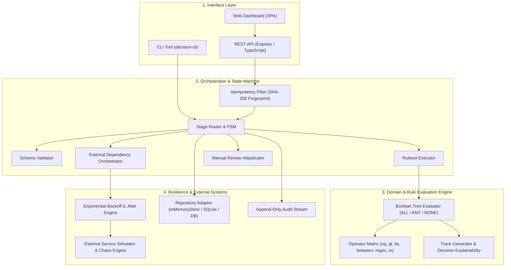
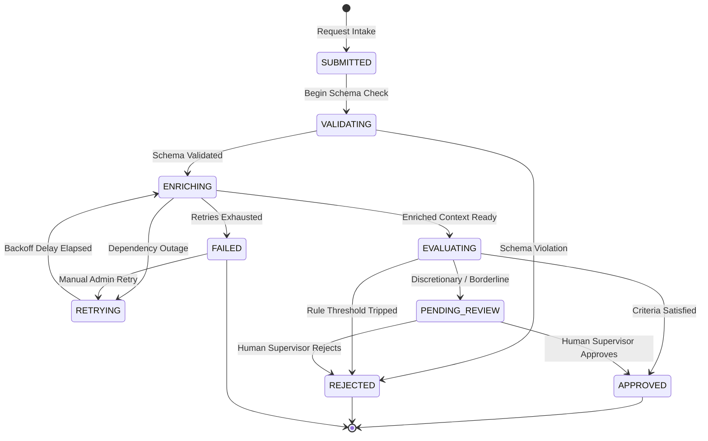

# Architecture & System Design Document
## Resilient Workflow Decision Platform

---

## 1. Executive Summary & Problem Understanding

Modern business operations require automated decisioning platforms that evaluate high-volume, structured requests against dynamic policy rules. Real-world platforms frequently encounter:
1. **Unstable External Integrations:** Third-party bureaus, sanction list screeners, and fraud engines experience transient latency, rate limits, and outages.
2. **Evolving Regulatory Policies:** Business risk appetite shifts frequently, requiring threshold and rule changes without redeploying code or risking regression.
3. **Operational Robustness:** Client retries can cause duplicate evaluations, non-deterministic state, and double-actioning without robust idempotency guarantees.
4. **Auditability & Regulatory Scrutiny:** Every decision must be traceable to the exact input data, external enrichment, and rule criteria evaluated.

This platform implements a **Configurable Workflow Decision Engine** adhering to Hexagonal Architecture, finite-state machine (FSM) semantics, declarative rule trees, and resilience patterns (circuit breaker, backoff retry, idempotency deduplication).

---

## 2. High-Level System Architecture

The platform separates concerns into four distinct layers: **Interfaces (REST API, UI, CLI)**, **Core Orchestration Engine**, **Domain & Rule Engine**, and **Resilience & Storage Adapters**.

---

## 3. Workflow State Machine Lifecycle

State transitions follow strict invariants. Illegal transitions are prevented by the `StateMachine` boundary.

---

## 4. Component Deep-Dive

### 4.1 Schema Intake & Validation Stage
- **Role:** Rejects malformed requests before committing resources or calling external systems.
- **Declarative Schema:** Workflows define field types (`string`, `number`, `boolean`, `array`, `object`), constraints (`min`, `max`, `regex`, `enum`), and required flags.
- **Fail-Fast:** Field-level violations are captured immediately, transitioning the execution to `REJECTED` with reason code `VALIDATION_ERROR`.

### 4.2 External Service Simulator & Chaos Injection
- **Simulated Dependencies:**
  - `credit_bureau`: Credit score, debt-to-income, open lines of credit.
  - `fraud_detection`: Anomaly risk scores, blacklist detection.
  - `kyc_verification`: ID document status, sanctions matches.
  - `vendor_registry`: Tax identification clearance, DUNS rating.
- **Configurable Chaos Modes:**
  - `HEALTHY`: Normal, deterministic mock responses.
  - `TRANSIENT_FAILURE`: Simulates temporary outages (e.g., 503) that fail $N$ times and then recover.
  - `PERMANENT_FAILURE`: Simulates sustained system outages to test retry exhaustion.
  - `TIMEOUT`: Simulates connection lag exceeding network timeouts.
  - `RATE_LIMIT`: Simulates HTTP 429 throttling.

### 4.3 Resilience & Idempotency Engine
- **Deterministic SHA-256 Fingerprinting:**
  $$H = \text{SHA256}(\text{JSON.stringify}(\text{sortedKeys}(payload)))$$
- **Duplicate Request Handling:**
  1. If an idempotency key is presented with an **identical payload**:
     - The platform detects the completed execution, skips external calls, and returns the cached outcome with header `X-Idempotent-Replay: true`.
  2. If an idempotency key is presented with a **different payload**:
     - The platform raises `IdempotencyConflictError` and returns HTTP `409 Conflict`, preventing payload tampering and race conditions.

### 4.4 Exponential Backoff with Jitter
When external integrations throw transient errors, the retry engine applies randomized exponential backoff:
$$T_{\text{delay}} = \min(T_{\text{max}}, T_{\text{initial}} \times M^{(\text{attempt} - 1)}) + \text{jitter}$$
Where $M$ is the backoff multiplier and jitter is randomly distributed between $0$ and $20\%$ of base delay to prevent "thundering herd" spikes.

### 4.5 Dynamic Rule Engine & Explainability
- **Operators Supported:** `eq`, `neq`, `gt`, `gte`, `lt`, `lte`, `between`, `in`, `not_in`, `contains`, `regex`, `exists`.
- **Boolean Composition:** Nested trees supporting `all` (AND), `any` (OR), and `none` (NOT).
- **Evaluation Modes:**
  - `FIRST_MATCH`: Evaluates rules by priority and halts on the first triggering condition.
  - `ACCUMULATE`: Evaluates all rules, collecting all flags, mutations, and warnings.
- **Explainability Trace Matrix:** For every evaluated rule, records:
  - Rule ID and Name
  - Tested path (e.g. `credit_bureau.creditScore`)
  - Actual value vs Threshold expected
  - Pass/Fail boolean
  - Human-readable natural language justification

---

## 5. Architectural Trade-offs & Design Defense

| Architectural Decision | Chosen Approach | Alternative Considered | Justification & Trade-off Defense |
|---|---|---|---|
| **Persistence Layer** | In-Memory Repository with Repository Interface | PostgreSQL / SQLite | **Rationale:** Ensures zero setup friction during review, runs instantly in any environment. **Defense:** Domain logic is strictly decoupled behind `IWorkflowRepository` and `IExecutionRepository` interfaces, allowing SQL/NoSQL drivers to be swapped with zero core engine modifications. |
| **Orchestration Execution** | Sequential Async Stage FSM | Event-Driven Microservices (Kafka/RabbitMQ) | **Rationale:** In-process stage execution provides strong transactional consistency, deterministic latency, and straightforward debugging for decision workflows. **Defense:** Distributed queues add operational complexity and eventual consistency lag, which is unnecessary for low-to-medium volume atomic decisioning. |
| **Rule Specification** | Declarative JSON AST | Embedded Scripting (Python `eval` / Lua) | **Rationale:** Declarative JSON trees are completely safe from arbitrary code injection (RCE), validateable against schemas, and editable by non-technical business analysts via forms/UIs. |
| **Idempotency Fingerprint** | Cryptographic Payload Hash | Client UUID Only | **Rationale:** Trusting client UUIDs blindly allows catastrophic bugs where two distinct operations reuse the same key. Hash comparison guarantees that identical keys with conflicting payloads are safely rejected with `409 Conflict`. |

---

## 6. Assumptions Made

1. **Stage Atomicity:** Individual stage executions are idempotent; if a stage fails midway, it can be safely retried without side-effect corruption.
2. **Context Immutability:** Context enrichment is additive; external service calls enrich the execution context rather than mutating initial client input.
3. **Synchronous Decision Expectation:** Client callers expect immediate or near-instantaneous decision resolution unless the request explicitly hits `PENDING_REVIEW`.

---

## 7. Scaling Considerations & Production Roadmap

For enterprise-scale deployment (10,000+ requests/sec):
1. **Distributed Idempotency & Locking:**
   - Migrate in-memory locks to Redis using Redlock or PostgreSQL advisory locks with TTLs.
2. **Event Sourcing & Audit Immutability:**
   - Store state transitions in an append-only event log (e.g., Apache Kafka or AWS Kinesis), using CQRS to project current execution status into read-optimized stores (Elasticsearch / Redis).
3. **Worker Pool & Backpressure:**
   - For asynchronous batch workflows, decouple request intake from execution using BullMQ or Celery worker pools with dead-letter queues (DLQ) for failed jobs.
4. **Partitioning:**
   - Partition execution and audit tables by `workflowId` and `hash(idempotencyKey)` across database shards.
